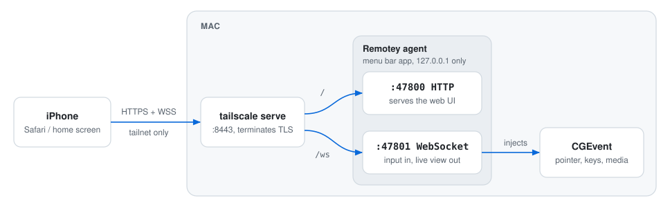

<p align="center">
  
</p>

<h1 align="center">Remotey</h1>

<p align="center">
  Use your iPhone as trackpad, keyboard and media remote for your Mac.<br>
  No iOS app to install: a web page on your home screen, reachable only inside your tailnet.
</p>

<p align="center">
  
  &nbsp;
  
  &nbsp;
  
</p>

## How it works



The live view uses hardware-encoded H.264 at up to 120 fps with a 4 Mbit/s average bitrate target. Safari 16.4+ can decode it through WebCodecs; unsupported browsers or encoders fall back to JPEG at up to 30 fps. The client measures its rendering cadence and requests up to 120 fps; the rate is also capped by the refresh rate of the fastest Mac display. A Mac with 60 Hz displays or Safari limited to 60 Hz stays at 60 fps. With several displays, each one is captured and the view is composed from those around the pointer, so it pans across the seam between two displays instead of switching; space no display covers is black. Zoomed out beyond the pointer's display, the view holds still and shows that display whole, then its neighbours, and at most the whole desktop.

The stream is built for a short way from finger to picture and for doing nothing whenever possible:

- The pointer is not part of the picture. The phone gets its place with every message and its image when the shape changes, and draws it itself, so pointer and marker cannot drift apart.
- A pointer move needs no screen capture. The agent cuts the new view from the frames it already holds the moment it posts the move. A move inside a view held by the display's edges sends 22 bytes and no picture.
- A still screen sends nothing, and neither does a change outside the view, such as a clock in the menu bar.
- One key frame starts the stream. The link is reliable, so no later one interrupts it.
- Pictures await a draw acknowledgement: two at first, then the agent sends while the oldest unanswered picture is younger than the fastest answer plus 200 ms. A jittery link keeps its frame rate, a slow one lowers it instead of building up a queue.

The agent is a small Swift menu bar app with no dependencies. The UI is an HTML page with a stylesheet and a few modules, split by what they change for: gestures (`touchpad.js`), the visible area and keyboard (`viewport.js`), the text field (`typing.js`), decoding and drawing (`live-view.js`), the app switcher (`apps.js`) and the wiring (`remote.js`). Labels are in German.

## Security

An input remote is remote control of your Mac, so the agent is locked down in three layers:

- It binds to `127.0.0.1` only. Nothing is reachable from your Wi-Fi.
- `tailscale serve` terminates TLS and admits only devices in your tailnet.
- Every WebSocket must authenticate with a 256-bit token first. This also stops web pages in your Mac's browser from talking to the loopback port. The token travels in the URL fragment of the pairing link, which is never sent to the server, and can be rotated from the menu.

The live view sends screen content only to an authenticated client, only while it is switched on, over the same TLS connection. The same holds for the app switcher: the names of the open apps, their icons and the titles of their windows leave the Mac only when an authenticated client opens it.

Connections that have not authenticated are closed after five seconds and limited to 32 at a time, so nobody without the token can exhaust the agent's sockets. The app is signed with the hardened runtime, so other processes on the Mac cannot load code into it and borrow its Accessibility and Screen Recording permissions.

A locked Mac stays within reach: the pointer, the keys and the live view work on its lock screen as on the desktop, so whoever holds the token can try passwords there, as someone at its keyboard can. Unlocking needs the password of the Mac's user. The phone sends it over the same TLS connection, the agent types it into the lock screen's password field and keeps no copy; it is in no log and no file on the Mac. Nothing is typed unless that field has the keyboard, so the password cannot land in an app on a Mac that is open.

Known limit: the token is a file in `~/Library/Application Support/Remotey`, readable by every unsandboxed process running as you. Such a process can connect to the loopback port and gets the same input and screen access as the phone.

## Setup

Requirements: macOS 14+, Xcode command line tools, Tailscale on the Mac and the iPhone (same account).

1. Build, sign and start the app:
   ```sh
   ./scripts/build.sh --install
   ```
2. Allow Remotey under System Settings → Privacy & Security → Accessibility.
   For the live view, also allow it under Screen & System Audio Recording and restart Remotey.
3. Publish the agent inside your tailnet (asks you to enable Serve once):
   ```sh
   ./scripts/tailscale-serve.sh
   ```
4. Click the menu bar icon → "iPhone koppeln (QR-Code)…" and scan the code with the iPhone camera.
5. In Safari, choose Share → Add to Home Screen.

The build signs with your "Apple Development" identity so macOS keeps the Accessibility permission across rebuilds. Set `REMOTEY_SIGN_IDENTITY` to use another one.

## Usage

| Gesture | Action |
|---|---|
| One finger | Move the pointer |
| Tap | Click |
| Two fingers together | Scroll. Lifting one finger ends the scroll; the other one does not move the pointer |
| Two fingers apart | Zoom the live view (pinch). The point the view is cut around stays in place |
| Two-finger tap | Right click |
| Three fingers | Drag: the left button is held while they move and let go when one lifts |
| Hold "Links" and swipe with a second finger | Drag |
| ‹ › | Back and forward, clicked as a mouse's side buttons (buttons 4 and 5). Chromium browsers and Firefox navigate on them; Safari and Finder ignore these buttons from any mouse unless a helper app translates them |
| ⌘ ⌥ ⌃ ⇧ | Applies to the next key or click, e.g. ⌘ then `w`, or ⌥ then a tap. Armed before holding "Links", it stays for the whole drag |
| "Bild" | Live view: the trackpad shows the screen around the pointer, so you steer on the picture itself |
| − / + (top right of the display) | Zoom the live view in steps up to 4×, and out until every display of the Mac is in the picture, upright or sideways; the readout between them shows the zoom, tap it for 1×. Upright and sideways each keep their own zoom |
| "Folgt Text" | While you type, the live view shows the text cursor on the Mac (or the focused field, if the app reports no cursor), and waits until the cursor nears an edge. Moving the pointer or clicking ends it. Neither the pointer nor the focus on the Mac moves |
| Readout at the top left of the display | Updates of the live view per second and the delay of a pointer move in milliseconds, measured from sending the move until the picture that shows it is drawn. Green is good, amber middling, red poor; grey while the screen is still |
| Dock | Under the thumb: ‹ and ›, "Links" and "Rechts", then "Tippen…", "Apps", the grid key and "Bild". Sideways it stands as a rail right of the display |
| "Apps" | Opens the switcher: the Mac's open apps as icons, the most recently used first. The app in front has an amber mark, a hidden one is dimmed. Tap an app and it comes to the front with the keyboard focus; a minimized window comes out of the Dock, a hidden app is shown. Put the switcher away like the tray: with its key, a tap on the display or a swipe down from its top edge |
| An app with a number | The app has that many windows. A tap shows their titles instead of switching, the one in front marked amber, minimized ones named so; tap the window you want. Nothing on the Mac moves before that choice. ‹ returns to the apps |
| After switching | With the live view on, the pointer goes to the middle of the window that came forward, unless it is inside it already, so the view shows that window. Without the live view the pointer stays where it is |
| Grid key | Opens media keys, key page and Regler as a tray that comes up out of the display's lower edge; the display keeps its size, so the live view runs on. Put it away with the grid key, a tap on the display (no click reaches the Mac) or a swipe down from its top edge |
| "Tippen…" | Opens the keyboard. Esc, Tab, ⌘ ⌥ ⌃ ⇧ and the arrows sit in a row right above it |
| "Entsperren…" (a padlock) | The Mac is locked, and the same key opens the field for its password. iOS masks it and offers the one saved for this page. Nothing leaves the phone while you type; the send key hands it to the Mac, which types it into its lock screen. The key says "Tippen…" again once the Mac is open; if it stays locked, the field says so. With the live view on you see the password field of the Mac meanwhile |
| A Mac whose display sleeps | Any move, click, scroll or key from the phone, and switching the live view on, wakes the display as a key on the Mac's keyboard does. The media keys leave it dark |
| "Medien" / "Tasten" / "Regler" | Slides between the media keys, the key page (Esc, Tab, modifiers, arrows) and the settings |
| "Regler" | Three sliders: pointer speed, acceleration (how much further a fast move reaches; "aus" is linear) and scroll speed. Touch the track where you want the value or slide along it; the thumb snaps to the detents, the longer tick marks the default. Each counts from the next move and is kept on the phone. "Std." restores the defaults |

The dot at the top left of the display is the connection: blinking amber while connecting, green when connected, red when not. The screenshots above show a placeholder instead of a real Mac screen, and made-up apps.

Text typed on the iOS keyboard is replayed on the Mac key by key.

## Development

```sh
swift run                          # agent from the source tree, Web/ is re-read on every request
REMOTEY_PORT=47820 swift run       # beside the installed app: page on 47820, socket on 47821
swift test                         # encoder, pointer, input, view, send window, wire format, order of apps, unlocking; server: auth, limits, list of apps
node --test scripts/               # client decode, pointer, zoom preview, gestures, viewport, text field, switcher
node scripts/ui-verify.mjs         # the page in headless Chromium: reachable controls, pinch, keyboard, pointer, scroll, Regler, tray, side buttons, switcher, locked Mac
node scripts/smoke.mjs              # running agent: HTTP, auth, pointer, list of apps and JPEG flow control
node scripts/smoke.mjs --focus      # also brings another app's window to the front and the one before back
node scripts/smoke.mjs --h264       # same checks for H.264, including IDR after restart/resize
node scripts/smoke.mjs --h264 --fps=120  # request 120 fps (requires a 120 Hz source display)
node scripts/bench.mjs --fps=60     # running agent: frame rate, delay from move to picture, CPU, bursts of moves
node scripts/lock.mjs               # running agent: locks the Mac, then pointer, live view, display wake and a refused password on the lock screen; you unlock at the end
```

`Sources/Remotey/Wire.swift` holds the agent's half of what agent and page say to each other. On the page each message lives in the module it serves: `Web/live-view.js` reads the live view's updates, `Web/apps.js` the switcher's lists, and `Web/remote.js` sends the commands and routes what arrives. A change to one half belongs in the other. Every file in `Web/` is served and bundled. A page that was loaded from an older agent reloads itself when it reconnects.

The scripts talk to the agent on `REMOTEY_PORT` (default 47800). The smoke tests and the benchmark move the pointer, so keep your hands off the mouse while they run. Close Remotey on the phone first, since the most recent viewer owns the stream. They measure the Mac's side: received frames, not displayed frames on the phone. The 4 Mbit/s setting is an average target, not a hard cap; the readout on the phone shows the frame rate and delay that actually arrive there.

The hardware encoder takes one picture at a time. On an M3 Max a picture for a full phone display (780 × 1688 pixels) needs about 7 ms to encode and 2.5 ms to compose, so that size tops out at 90 to 100 fps; the smaller display above the keys reaches 120 fps.

Known limits: characters without a key in the active layout (emoji, for example) are sent as Unicode events, which some terminals ignore. On the lock screen, Esc puts the display to sleep, and macOS does so itself about 30 seconds after the last input; the picture on the phone then stands still until the next input wakes the display. A Mac that sleeps itself, not only its display, is out of reach until something wakes it. After a restart nothing runs before the first login, so the login window (and FileVault's) cannot be reached. A screen saver over the lock screen is untested. The switcher learns an app's windows from Accessibility, which reports those of the current Space and the minimized ones. An app whose windows are on another Space or in full screen shows no number; a tap brings it forward as a click in the Dock does, which switches to its Space, and from there the switcher lists its windows.

## License

MIT
