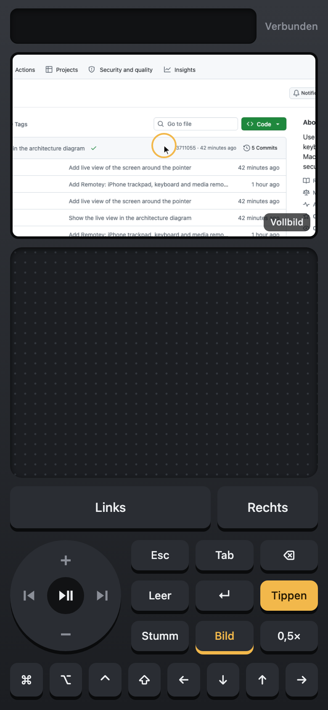

<p align="center">
  
</p>

<h1 align="center">Remotey</h1>

<p align="center">
  Use your iPhone as trackpad, keyboard and media remote for your Mac.<br>
  No iOS app to install: a web page on your home screen, reachable only inside your tailnet.
</p>

<p align="center">
  
  &nbsp;
  
  &nbsp;
  
</p>

## How it works


The live view uses hardware-encoded H.264 at up to 120 fps with a 4 Mbit/s average bitrate target. Safari 16.4+ can decode it through WebCodecs; unsupported browsers or encoders fall back to JPEG at up to 30 fps. The client measures its rendering cadence and requests up to 120 fps; capture is also capped by the Mac display’s refresh rate. A 60 Hz display or Safari limited to 60 Hz stays at 60 fps. Static screen samples are not encoded. With several displays, each one is captured and the view is composed from those around the pointer, so it pans across the seam between two displays instead of switching; space no display covers is black. At most two frames await a draw acknowledgement, so a slow connection lowers the frame rate instead of building up a queue.

The agent is a small Swift menu bar app with no dependencies. The UI is an HTML page with a small decoder module (labels are in German).

## Security

An input remote is remote control of your Mac, so the agent is locked down in three layers:

- It binds to `127.0.0.1` only. Nothing is reachable from your Wi-Fi.
- `tailscale serve` terminates TLS and admits only devices in your tailnet.
- Every WebSocket must authenticate with a 256-bit token first. This also stops web pages in your Mac's browser from talking to the loopback port. The token travels in the URL fragment of the pairing link, which is never sent to the server, and can be rotated from the menu.

The live view sends screen content only to an authenticated client, only while it is switched on, over the same TLS connection.

Connections that have not authenticated are closed after five seconds and limited to 32 at a time, so nobody without the token can exhaust the agent's sockets. The app is signed with the hardened runtime, so other processes on the Mac cannot load code into it and borrow its Accessibility and Screen Recording permissions.

Known limit: the token is a file in `~/Library/Application Support/Remotey`, readable by every unsandboxed process running as you. Such a process can connect to the loopback port and gets the same input and screen access as the phone.

## Setup

Requirements: macOS 14+, Xcode command line tools, Tailscale on the Mac and the iPhone (same account).

1. Build, sign and start the app:
   ```sh
   ./scripts/build.sh --install
   ```
2. Allow Remotey under System Settings → Privacy & Security → Accessibility.
   For the live view, also allow it under Screen & System Audio Recording and restart Remotey.
3. Publish the agent inside your tailnet (asks you to enable Serve once):
   ```sh
   ./scripts/tailscale-serve.sh
   ```
4. Click the menu bar icon → "iPhone koppeln (QR-Code)…" and scan the code with the iPhone camera.
5. In Safari, choose Share → Add to Home Screen.

The build signs with your "Apple Development" identity so macOS keeps the Accessibility permission across rebuilds. Set `REMOTEY_SIGN_IDENTITY` to use another one.

## Usage

| Gesture | Action |
|---|---|
| One finger | Move the pointer |
| Tap | Click |
| Two fingers | Scroll |
| Two-finger tap | Right click |
| Hold "Links" and swipe with a second finger | Drag |
| ⌘ ⌥ ⌃ ⇧ | Applies to the next key, e.g. ⌘ then `w` |
| "Bild" | Live view: the trackpad shows the screen around the pointer, so you steer on the picture itself |
| Zoom switch | Tap a position or slide across them (0.25× to 2×) |
| Full view key | The keys fold away and the display takes the phone; the keyboard key opens typing. Turning the phone sideways does the same with the controls beside the display |
| "Medien" / "Tasten" | Slides between the media keys and the key page (Esc, Tab, modifiers, arrows) |

The dot left of the zoom switch is the connection: blinking amber while connecting, green when connected, red when not. The screenshots above show a placeholder instead of a real Mac screen.

Text typed on the iOS keyboard is replayed on the Mac key by key.

## Development

```sh
swift run                          # agent from the source tree, Web/ is re-read on every request
swift test                         # hardware encoder; server: auth and limits for unauthenticated connections
node --test scripts/live-view.test.mjs  # client decode, acknowledgements and JPEG fallback
node scripts/smoke.mjs              # running agent: HTTP, auth, pointer and JPEG flow control
node scripts/smoke.mjs --h264       # same checks for H.264, including IDR after restart/resize
node scripts/smoke.mjs --h264 --fps=120  # request 120 fps (requires a 120 Hz source display)
```

The smoke tests move the pointer. Close Remotey on the phone first, since the most recent viewer owns the stream. They measure received frames, not displayed frames on the phone. The 4 Mbit/s setting is an average target, not a hard cap; actual frame rate, latency and text quality still need verification on the iPhone.

Known limits: untested on the Mac lock screen, and characters without a key in the active layout (emoji, for example) are sent as Unicode events, which some terminals ignore.

## License

MIT
