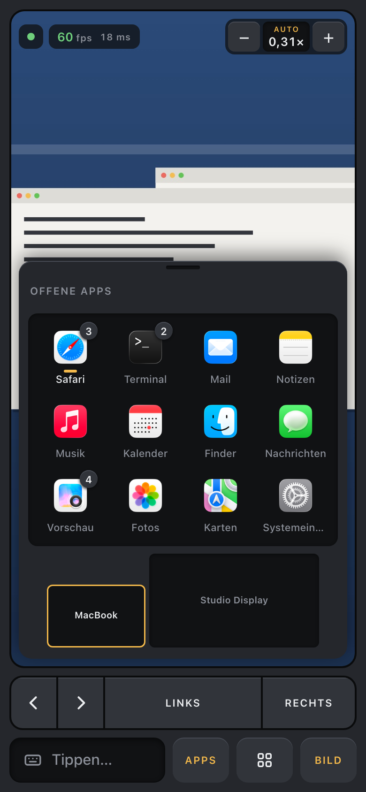
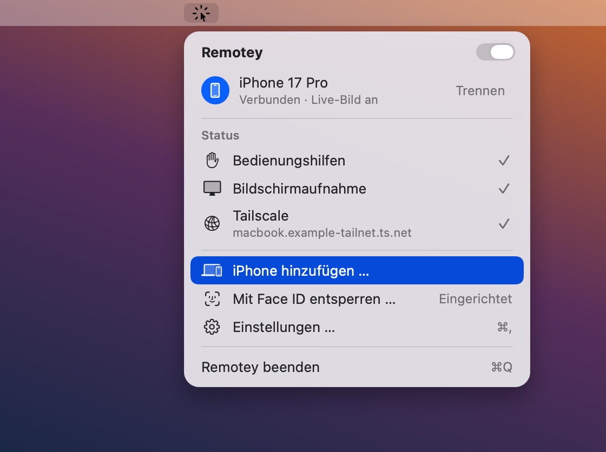
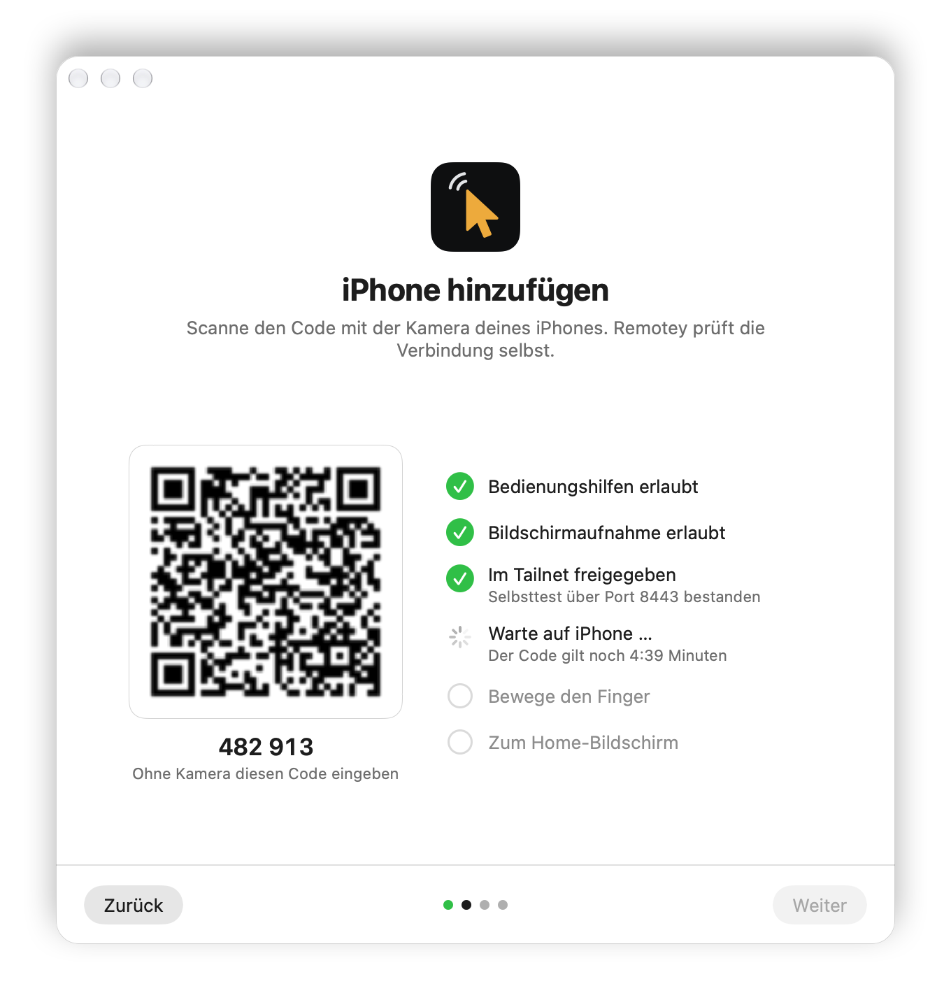
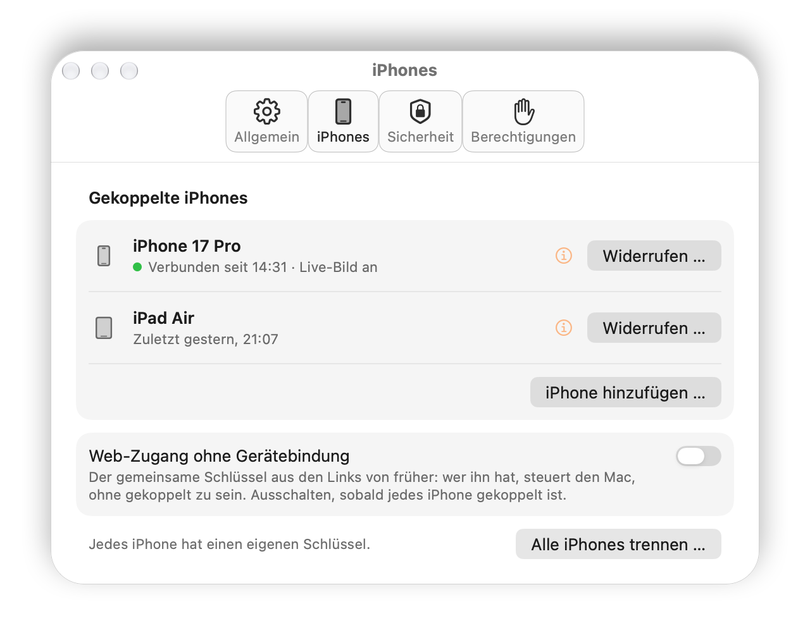

<p align="center">
  
</p>

<h1 align="center">Remotey</h1>

<p align="center">
  Use your iPhone as trackpad, keyboard, live view and media remote for your Mac.<br>
  No iOS app to install: a web page on your home screen, reachable only inside your tailnet.
</p>

<p align="center">
  
  &nbsp;
  
  &nbsp;
  
</p>

## How it works


The live view uses hardware-encoded H.264 at up to 120 fps, with an average bit rate of 4 Mbit/s on a link that carries it and as much less as the link asks for. Safari 16.4+ can decode it through WebCodecs; unsupported browsers or encoders fall back to JPEG at up to 30 fps, and so does a page whose decoder failed three times in 10 seconds. The client measures its rendering cadence and requests up to 120 fps; the rate is also capped by the refresh rate of the fastest Mac display. A Mac with 60 Hz displays or Safari limited to 60 Hz stays at 60 fps. With several displays, each one is captured and the view is composed from those around the pointer, so it pans across the seam between two displays instead of switching; space no display covers is black. Zoomed out beyond the pointer's display, the view holds still and shows that display whole, then its neighbours, and at most the whole desktop.

The picture covers the whole phone and the controls float over it. The page tells the agent which edges they cover, and the agent places the view for the rectangle in between: the pointer, a fitted window and the text cursor stay clear of the controls, and the picture still runs on under them.

The stream is built for a short way from finger to picture and for doing nothing whenever possible:

- The pointer is not part of the picture. The phone gets its place with every message and its image when the shape changes, and draws it itself, so pointer and marker cannot drift apart.
- With "An iPhone anpassen" (Fit to iPhone) the pointer does not wait for the Mac. The phone draws it where a move takes it the moment the finger moves, and adds the moves that are still under way to every place the Mac names. For that it sends whole points, knows the Mac's displays and stops the pointer at their edges as the Mac does. So the pointer follows the finger at once, at home and over a relay with a round trip of 100 to 400 ms. This is for a picture that stands still, as a window in the phone's shape does. Where the picture follows the pointer, with "Fenster einpassen" (Fit Window) alone or a zoom set by hand, the pointer waits for the Mac with it: tried on the phone, a pointer that runs ahead of its picture and comes back as the picture catches up was harder to steer.
- A pointer move needs no screen capture. The agent cuts the new view from the frames it already holds the moment it posts the move. A move inside a view held by the display's edges sends 47 bytes and no picture.
- A still screen sends nothing once it is sharp, and neither does a change outside the view, such as a clock in the menu bar. A picture that no other followed for 150 ms is encoded again, until the encoder has nothing to add: in motion a picture gets the bits its bit rate has for one frame, and the last one would stay as soft as that left it.
- One key frame starts the stream. The link is reliable, so no later one interrupts it, unless the page asks for one after a decoder error or 2 seconds without a picture; the agent grants at most one a second.
- Pictures await a draw acknowledgement: two at first, then the agent sends while the oldest unanswered picture is younger than the fastest answer plus 200 ms. A jittery link keeps its frame rate, a slow one lowers it instead of building up a queue.
- The bit rate fits the link. Where pictures queue, their answers all late and evenly spaced, the rate goes a little below what the link carried; it rises again while the stream uses it and no queue shows. A link that only holds packets back and then hands them over at once keeps its bit rate. Below 0.75 bits a second for a pixel the picture is sent at three quarters or half its width, since a slow link carries a key frame or a new page of text for seconds, and fewer pixels are there sooner.

The agent is a Swift menu bar app with no dependencies. Its menu, setup assistant and settings are SwiftUI inside AppKit; their words are German only (`Sources/Remotey/Texts.swift`). The UI on the phone is an HTML page with a stylesheet and a few modules, split by what they change for: gestures (`touchpad.js`), the visible area and keyboard (`viewport.js`), the text field (`typing.js`), the passkey (`passkey.js`), decoding and drawing (`live-view.js`), the app switcher (`apps.js`), the display picker (`displays.js`), the connection's states (`connection.js`), pairing and tickets (`pairing.js`), the gesture tour (`tour.js`), the screen's wake lock (`awake.js`), every word in German and English (`strings.js`) and the wiring (`remote.js`). The page speaks the first of the phone's languages it knows, and English for any other. Below, a control is named by its German label with the English one after it.

## Security

An input remote is remote control of your Mac. What keeps it to your phones, layer by layer:

- **Loopback only.** The agent binds to `127.0.0.1`. Nothing is reachable from your Wi-Fi.
- **Tailnet only.** `tailscale serve` terminates TLS and admits only devices in your tailnet. A request that came through Funnel from the internet is refused, and the setup assistant shows a Funnel on port 8443 as an error with a key to remove the mapping. Behind `serve`, the agent reads Tailscale's identity header: a request from a person other than the Mac's owner is refused, on both ports and in the WebSocket handshake. `serve` deletes any such header a request brings and sets its own, so it cannot be faked from the tailnet. Where the owner is not known (a tagged Mac, Tailscale not answering yet) or the header is missing, the request is let in, so the rule never keeps your own phone out; then only pairing does.
- **Origin and Host.** The agent takes only `Host` values of 127.0.0.1, localhost, ::1 or a name under `.ts.net`, on both ports, and the same for `Origin` on the WebSocket handshake; `Origin: null` is refused there. The two pairing routes take only `Content-Type: application/json`, which a page from another origin cannot send without a CORS preflight that the agent never answers. This stops a web page in the Mac's browser from talking to the loopback ports, also by DNS rebinding. It does not stop a program on the Mac, which can send any header it likes.
- **Pairing per device.** The QR code links to `https://<mac>.<tailnet>.ts.net:8443/#p=<code>` with a 128-bit one-time code in the fragment, which the browser never sends to a server. Beside the QR code the Mac shows six digits that pair just as well, for a phone without a camera or a Home Screen app that needs the code again. Codes exist only while the pairing step of the assistant is on the Mac's screen, for five minutes at most; the first use spends both, and five wrong tries end the offer. The page posts the code, and the agent answers with a 256-bit key for this device in a cookie that is `HttpOnly` (scripts cannot read it), `SameSite=Strict`, `Secure` and kept for 400 days, renewed by every session. The page then removes the code from its address. The Mac keeps only a SHA-256 hash of each key in `~/Library/Application Support/Remotey/devices`, so that file opens nothing. Settings → iPhones lists every device with when it was paired, when it was last seen and the Tailscale login it paired from; "Widerrufen …" (revoke) disconnects one device at once and keeps it out, "Alle iPhones trennen …" all of them.
- **Tickets.** Before every connection the page trades its cookie for a ticket (`POST /session`) and opens the socket with it. A ticket is good once and for 30 seconds. A ticket of a device revoked since says so, and the page asks to pair again.
- **The old shared token.** Phones paired before devices existed used one 256-bit token for everyone, in the link and in the phone's storage. Such a phone becomes a device the first time it connects and forgets the token. The agent still accepts the token while "Web-Zugang ohne Gerätebindung" (Settings → iPhones) is on, which it is by default, also on a fresh install. Switch it off once every phone is paired; that disconnects the phones still using it. The live scripts in `scripts/live/` use the token and stop working while it is off.
- **Limits on connections.** A connection that has not authenticated is closed after five seconds, and at most 32 wait at a time, so nobody without a key can exhaust the agent's sockets.
- **Heartbeat.** The page says `ping` every five seconds while it is in sight. After 10 seconds of silence the agent lets go of the buttons and scroll that phone holds, after 15 seconds it closes the connection, which stops the live view and gives a window in the phone's shape its frame back. A phone that dropped off mid-drag does not leave a button held.
- **Pause.** The switch in the menu's head ("Fernsteuerung") pauses remote control: the agent drops input, live view, app list, unlocking and Face ID setup from every phone, lets go of held buttons and stops the picture. Nobody is unpaired; the phones say "Pausiert" (Paused) until it is switched on again.
- **Hardened runtime.** The app is signed with it, so other processes on the Mac cannot load code into it and borrow its Accessibility and Screen Recording permissions.

The live view sends screen content only to an authenticated client, only while it is switched on, over the same TLS connection. The same holds for the app switcher: the names of the open apps, their icons, the titles of their windows and the names of the displays leave the Mac only when an authenticated client opens it.

A locked Mac stays within reach: the pointer, the keys and the live view work on its lock screen as on the desktop, so whoever holds a paired phone can try passwords there, as someone at its keyboard can. Unlocking needs the password of the Mac's user. The phone sends it over the same TLS connection, the agent types it into the lock screen's password field and keeps no copy; it is in no log and no file on the Mac. The agent types it in blocks of four characters, and before each block and before Return it checks that the Mac is still locked and the field still has the keyboard. If Touch ID or a Watch opens the Mac meanwhile, at most one block reaches the app in front, and Return never does. Whether 25 ms between blocks is enough on a real lock screen is not yet tested.

Unlocking with Face ID is off until you set it up at the Mac, where you type the Mac's password once. A password that cannot be checked against the directory has to be typed twice. The phone then holds a passkey for this page, and the agent keeps the password in `~/Library/Application Support/Remotey/face-unlock`, encrypted with a key that only this passkey gives out, and only after iOS has verified you (WebAuthn's PRF extension). The file alone opens nothing. To unlock, the phone signs a fresh challenge from the agent and sends the passkey's secret over the same TLS connection; the agent checks the signature, decrypts, types the password into the lock screen and keeps neither. Every unlock asks iOS anew, a recorded answer is refused, and a password the Mac refuses twice in a row is deleted.

The passkey's secret also changes with every unlock: the agent asks the phone for the secret of a fresh salt alongside the current one, seals the password again under the new one, and writes it to the file once the Mac is open. A secret someone recorded on the loopback path then opens nothing after the next unlock. This needs the browser to return the second PRF value. If it does not, the unlock works as before and the secret stays the same; whether Safari on iOS returns it has not been checked on a real iPhone.

What Face ID changes: whoever holds your iPhone and can unlock it can unlock the Mac. iOS takes the phone's code where Face ID fails, unless Stolen Device Protection is on. The passkey syncs through iCloud Keychain to your other devices, which still need to be paired and in the tailnet. An enrolment takes the first connected phone that answers within two minutes, so start it only while no phone but yours is connected.

Known limits:

- A process running as you can read the files in `~/Library/Application Support/Remotey`. While the old token is accepted, it can read it and gets the same input and screen access as a phone. With the token off it finds only hashes, but it can still reach the loopback ports, send any header, and try the six digits while a pairing offer is open, five times per offer.
- The checks of `Host`, `Origin` and Tailscale's headers follow Tailscale's source on `main`; a real handshake through `tailscale serve` has not been recorded.
- "Trennen" (disconnect) in the menu ends a session: the phone is told so and stays away until its user taps "Wieder verbinden" (Connect Again) or opens the page anew. It is no lock. To keep a phone out, revoke it or pause remote control.

## Setup

Requirements: macOS 14+, the Xcode command line tools, an "Apple Development" signing identity (from Xcode, free with an Apple ID), and Tailscale on the Mac and the iPhone, signed in to the same account.

1. Build, sign and start the app from the source:
   ```sh
   ./scripts/build.sh --install
   ```
   It signs with your "Apple Development" identity so macOS keeps the permissions across rebuilds. Set `REMOTEY_SIGN_IDENTITY` to use another one.
2. The setup assistant opens on the first start, and on every start where a required point is missing. Work down its list until every row is green:
   - **Bedienungshilfen** (Accessibility) and **Bildschirmaufnahme** (Screen Recording, only for the live view): "Erlauben …" asks macOS, which lists Remotey in System Settings. You switch it on there; macOS does not let an app do that. The row turns green by itself. That the live view then starts without restarting Remotey is expected but not yet measured; if the phone still says the permission is missing, quit and start Remotey.
   - **Tailscale**, **HTTPS im Tailnet** and **Freigabe im Tailnet** (the mapping): the assistant finds Tailscale, says what is missing and offers one key per row: download, open, sign in, turn on. If HTTPS certificates are off in your tailnet, the row opens its admin page. "Freigeben" sets up `tailscale serve` on port 8443 for you; if your tailnet has not allowed Serve yet, it opens Tailscale's consent page in the browser, you agree there, and the row goes on by itself. Then it checks the address. Tailscale usually refuses that check from the Mac itself, and the row then says that the iPhone will show whether the address answers.
   - **Beim Anmelden starten** (start at login) is ticked on the first start. Untick it if you do not want it.
3. "Weiter" leads to "iPhone hinzufügen" (add iPhone): scan the QR code with the iPhone's camera. The page pairs by itself. Without the camera, open `https://<mac>.<tailnet>.ts.net:8443` in Safari and type the six digits under the code.
4. "Bewege den Finger" (move your finger): one finger over the phone. The step turns green with the first move.
5. "Zum Home-Bildschirm": in Safari, Share → Add to Home Screen, then open Remotey from there. If the Home Screen app asks for a code, type the six digits the step shows. The step turns green when a phone connects from the Home Screen.

Later, "iPhone hinzufügen …" in the menu opens the pairing step again, and "Einrichtung öffnen …" in Settings → Allgemein the whole list.

What you still do by hand: build from source, install Tailscale on both devices, switch on the two permissions in System Settings, agree to Serve and HTTPS in your tailnet's admin page when Tailscale asks, add the page to the Home Screen. If Tailscale runs as a Homebrew service that is stopped, the row copies the `sudo brew services` command for the Terminal.

The assistant's Tailscale keys run the same two commands as `scripts/tailscale-serve.sh`, but applying, removing and signing in have only been tested against made-up output of Tailscale, not yet against the real tool. If "Freigeben" fails, the script does the same from the Terminal:

```sh
./scripts/tailscale-serve.sh    # undo with: tailscale serve --https=8443 off
```

<p align="center">
  <picture>
    <source media="(prefers-color-scheme: dark)" srcset="docs/menu-dark.png">
    
  </picture>
</p>
<p align="center">
  <picture>
    <source media="(prefers-color-scheme: dark)" srcset="docs/setup-dark.png">
    
  </picture>
  &nbsp;
  <picture>
    <source media="(prefers-color-scheme: dark)" srcset="docs/settings-dark.png">
    
  </picture>
</p>

The pictures show made-up devices and a made-up tailnet.

## Usage

The live view covers the phone; the controls float over it. Upright, the Mac button sits at the top left, the view capsule at the top right, the mouse buttons and the bar at the bottom. Sideways, the same controls stand in the phone's two side margins; "Maustasten rechts" (Mouse Keys on the Right) in the settings swaps the sides. A gesture tour runs once on the first start and teaches the gestures on the real trackpad; it is under "Gesten …" (Gestures…) in the Mac button's menu and in the settings.

| Gesture | Action |
|---|---|
| One finger | Move the pointer |
| Tap | Click |
| Two fingers together | Scroll. Lifting one finger ends the scroll; the other one does not move the pointer |
| Two fingers apart | Zoom the live view (pinch). The point the view is cut around stays in place |
| Two-finger tap | Right click |
| Three fingers | Drag: the left button is held while they move and let go when one lifts |
| Hold "Klick" (Click) and swipe with a second finger | Drag |

| Control | What it does |
|---|---|
| ‹ › | Back and forward, clicked as a mouse's side buttons (buttons 4 and 5). Chromium browsers and Firefox navigate on them; Safari and Finder ignore these buttons from any mouse unless a helper app translates them |
| Mac button (top left) | The Mac's name and the connection's state as a sign and a word ("Verbunden", "Gesperrt", "Pausiert", or why it is not connected). Its menu switches the live view on and off ("Live-Bild"), locks the Mac ("Mac sperren"), and opens the tour and the settings. With "Bildrate und Verzögerung zeigen" on, it shows frames per second and the delay from a pointer move to the picture that shows it in place of the name; the menu always shows them |
| "Live-Bild" (Live view, top right) | Stands where the view capsule goes while the live view is off. Without it the trackpad is a plain surface, with a hint until the first move and a ring where a click landed |
| − / + | Zoom the live view in steps up to 4×, and out until every display of the Mac is in the picture. Upright and sideways each keep their own zoom |
| The readout between − and + | Shows the zoom, with a window sign while "Fenster einpassen" is on, a phone while "An iPhone anpassen" is on, and a text cursor while the view follows what you type. A tap opens the view's menu: "Fenster einpassen" (Fit Window), "An iPhone anpassen" (Fit to iPhone), "Originalgröße" (Actual Size), "Ganzer Schreibtisch" (Whole Desktop), and on a Mac with more than one display a map of them |
| "Fenster einpassen" | Fits the view to the window in front: it fills the phone's width or height, whichever limits, at twice its size at most. It fits again when another window comes forward (switcher, ⌘Tab, a click) and when the phone turns; a moved or resized window is fitted once it holds still. Near an edge of the picture the pointer pushes the view, so the menu bar stays within reach. A pinch or − / + ends it. Needs Accessibility; without a window in front (the desktop, the lock screen) the zoom set by hand counts |
| "An iPhone anpassen" | With "Fenster einpassen", the window in front also takes the phone's shape on the Mac. − / + and a pinch then ask for a smaller or larger window. It gets its frame back when another window comes forward, the live view goes off, the page goes out of sight or the phone disconnects. Only document and main windows are shaped, no dialogs and none in full screen. Switching it on switches fitting on |
| Following the text | While you type, the view shows the text cursor on the Mac (or the focused field, if the app reports no cursor) and waits until it nears an edge. Moving the pointer or clicking ends it |
| The displays in the view's menu | Arranged as on the Mac, the one with the pointer framed. A tap puts the pointer there, and the view with it: back where it last left that display this way, else to its middle |
| "Auf dem Mac schreiben" (Type on the Mac) | Opens the keyboard. esc, tab, ⌘ ⌥ ⌃ ⇧ and the arrows sit in a capsule above it. Text is replayed on the Mac key by key; long text goes in pieces |
| ⌘ ⌥ ⌃ ⇧ | Apply to the next key or click, e.g. ⌘ then `w`, or ⌥ then a tap. Armed before holding "Klick", one stays for the whole drag |
| "Apps" | The Mac's open apps as a grid, the most recently used first; the app in front on a light tile with a dot, a hidden one dimmed. A tap brings it to the front with the keyboard focus, out of the Dock if minimized. An app with a number has that many windows: a tap lists them, the one in front ticked, and nothing on the Mac moves before you choose one. With the live view on, the pointer goes to the middle of the window that came forward |
| "Steuerung" (Controls) | Two pages. "Medien" (Media): previous, play or pause, next, "Stumm" (Mute), quieter and louder, and "Mac sperren" (Lock Mac), which locks the Mac as ⌃⌘Q does. "Tasten" (Keys): esc, tab, space, delete, return, the modifiers, the arrows and the app's zoom (⌘−, ⌘0, ⌘+), which scales the content of browsers, editors and terminals |
| Sheets | Apps, Controls and Settings come up from the bottom. They are not modal: moving and scrolling on the picture above them go on. A tap on the picture, a swipe down or ✕ puts them away |
| "Einstellungen" (Settings) | Pointer speed, acceleration (how much further a fast move reaches; "aus" is linear) and scroll speed, with "Zurücksetzen" (Reset). "Fenster einpassen", "An iPhone anpassen", the frame rate readout, "Maustasten rechts" and "Durchsichtige Flächen" (See-Through Surfaces). Each is kept on the phone. At the end, the name this phone is paired as |
| A locked Mac | The Mac button says "Gesperrt" (Locked), and the writing key becomes the main action: "Mit Face ID entsperren" (Unlock with Face ID) where it is set up, else "Mac entsperren" (Unlock Mac), which opens a field for the password. iOS masks it and offers the one saved for this page; nothing leaves the phone before the send key. After a declined Face ID or a refused password ("Abgelehnt"), the next tap opens the field. The lock tile and the menu's lock unlock the same way |
| Setting up Face ID | At the Mac: "Mit Face ID entsperren …" in the menu, or Settings → Sicherheit. Type the Mac's password, then tap "Einrichten" (Set Up) on the card that lies over the phone for two minutes, and save the passkey in Passwords. "Entfernen …" in Settings → Sicherheit deletes the stored password; the passkey itself you delete in Passwords on the phone. After a changed password on the Mac, set it up again |
| A Mac whose display sleeps | Any move, click, scroll or key from the phone, and switching the live view on, wakes the display as a key on the Mac's keyboard does. The media keys leave it dark |

When the phone cannot connect, a notice over the dimmed picture says why and offers one action: the Mac out of reach, Remotey not running, a missing permission, a pairing no longer valid, the phone offline, remote control paused, or the live view on another device ("Hierher holen", Show It Here). The phone retries on its own, at once after a tap or when it comes back online. "Durchsichtige Flächen" off, or Reduce Transparency or Increase Contrast on the phone, puts the controls on solid ground instead of blurred glass.

The pictures above show a drawn stand-in for a real Mac screen, and made-up apps.

## Development

```sh
swift run                          # agent from the source tree, Web/ is re-read on every request
REMOTEY_PORT=47820 swift run       # beside the installed app: page on 47820, socket on 47821, the same token, its own devices and Face ID files
swift test                         # needs Xcode, not only the command line tools (XCTest)
node --test scripts/*.test.mjs     # the page's modules: decoding, pointer, gestures, connection, pairing, passkey, words, tour
node scripts/ui-verify.mjs         # the page in headless Chromium against a fake Mac; prints a report
node scripts/ui-verify.mjs --shots=DIR    # also saves pictures of the moments the checks measure
node scripts/ui-verify.mjs --gallery=DIR  # every screen in dark and light, and the main view on every phone size, upright and sideways, in both languages
node scripts/ui-verify.mjs --docs=DIR     # the README's phone pictures (remote.png, apps.png, keys.png)
node scripts/pairing-e2e.mjs       # the agent headless and the real page in Chromium: pairs by code, connects with a ticket, a finger arrives as moves
scripts/mac-pictures.sh DIR        # the Mac's menu, assistant, settings and Face ID window, drawn off screen in light and dark
scripts/mac-pictures.sh --before COMMIT DIR  # the same for an older commit, built in a temporary worktree
```

Name the test files as above: `node --test scripts/` runs them on Node 26 but finds none on Node 24. `ui-verify.mjs` and `pairing-e2e.mjs` need chrome-headless-shell in the Playwright cache (`npx playwright install --only-shell chromium`). `ui-verify.mjs` reports without judging; `.github/check-ui-verify.mjs` fails on every `ok` in its JSON report (`--json=FILE`) that is not true. `pairing-e2e.mjs` needs a built agent (`swift build`, or `--agent=PATH`).

`REMOTEY_HEADLESS=1` with a `REMOTEY_PORT` other than 47800 starts the agent without a menu bar icon, windows or permission prompts, opens a pairing offer at once, and writes every input event to stdout instead of posting it. Its token, devices and Face ID file live in a temporary folder that goes when it ends. `pairing-e2e.mjs` uses it, so it runs on a Mac someone is working at.

`scripts/mac-pictures.sh` draws with made-up data and does not start the agent. Pictures drawn off screen show inactive windows (grey switches and traffic lights) and the menu's material as a flat colour.

CI (`.github/workflows/ci.yml`) runs on a hosted Mac (`macos-26`, Node 24) for every pull request and every push to `main` and `development`: `swift build --build-tests`, `swift test`, the Node tests, `ui-verify.mjs` with its check, and `pairing-e2e.mjs`. A hosted Mac has no Accessibility and no Screen Recording permission; no test needs them. On a failure it keeps the Swift log, the report and the pictures.

The scripts in `scripts/live/` act on this Mac through its running agent: they move the pointer, bring windows forward or lock the Mac. Each one does nothing unless the command line carries `--live`, and `lock.mjs` also `--lock-mac`. They authenticate with the old shared token, so they need "Web-Zugang ohne Gerätebindung" on:

```sh
node scripts/live/smoke.mjs --live              # running agent: HTTP, auth, pointer, lists of apps and displays, JPEG flow control, a fitted view, the pointer drawn ahead against the Mac's
node scripts/live/smoke.mjs --live --focus      # also brings another app's window to the front and the one before back
node scripts/live/smoke.mjs --live --display    # also puts the pointer on another display and back
node scripts/live/smoke.mjs --live --h264       # same checks for H.264, including IDR after restart/resize
node scripts/live/smoke.mjs --live --h264 --fps=120  # request 120 fps (requires a 120 Hz source display)
node scripts/live/bench.mjs --live --fps=60     # running agent: frame rate, delay from move to picture, CPU, bursts of moves
node scripts/live/bench.mjs --live --fps=60 --still --seconds=30 --link=relay,2mbit  # what a phone shows over a modelled link: wifi, relay, a rate such as 2mbit, or relay with a rate
node scripts/live/lock.mjs --live --lock-mac    # running agent: locks the Mac, then pointer, live view, display wake and a refused password on the lock screen; you unlock at the end
node scripts/live/lock.mjs --live --lock-mac --password-stdin  # unlocks the Mac itself with the password from stdin
```

`Sources/Remotey/Wire.swift` holds the agent's half of what agent and page say to each other. On the page each message lives in the module it serves: `Web/live-view.js` reads the live view's updates, `Web/apps.js` the switcher's lists, `Web/displays.js` the list of displays, `Web/passkey.js` writes what the phone's passkey says, `Web/pairing.js` the pairing and the first message, and `Web/remote.js` sends the commands and routes what arrives. A change to one half belongs in the other. Every file in `Web/` is served and bundled. A page that was loaded from an older agent reloads itself when it reconnects. The words of the page are in `Web/strings.js`, those of the Mac in `Sources/Remotey/Texts.swift`, and those of the setup checklist in `Sources/Remotey/Setup.swift`. `docs/decisions.md` records what was built, decided and measured, and what is not verified.

The live scripts talk to the agent on `REMOTEY_PORT` (default 47800) and say `ping` every 5 s, as the page does. The smoke tests and the benchmark move the pointer, so keep your hands off the mouse while they run. Close Remotey on the phone first, since the most recent viewer owns the stream. They measure the Mac's side: received frames, not displayed frames on the phone. The bit rate is an average target, not a hard cap; the readout on the phone shows the frame rate and delay that actually arrive there. `REMOTEY_TEST_PATTERN=1` gives the agent a moving pattern instead of the screen, `rests` one that moves and holds still in turn, and `REMOTEY_STATS=1` writes what each stage did every second, with the bit rate and the picture's size.

The hardware encoder takes one picture at a time. On an M3 Max a picture for a full phone display (780 × 1688 pixels) needs about 7 ms to encode and 2.5 ms to compose, so that size tops out at 90 to 100 fps.

What comes next, and what was put off on purpose, is in [docs/roadmap.md](docs/roadmap.md).

## Known limits

- The phone's glass layout, pairing per device and the gesture tour have not yet run on a real iPhone: they were checked in Chromium with touch emulation. What the blur over a running picture costs on an iPhone is not measured; if the picture stutters, switch "Durchsichtige Flächen" off.
- The Mac's menu, assistant and settings were tested as values and as pictures drawn off screen; their first run on a real screen is still open. Their words are German only.
- A Home Screen app may start without Safari's cookie. It then asks once for the six digits; whether iOS carries the cookie over is not yet known.
- Where no direct connection comes about, as with both ends behind a carrier's NAT, Tailscale relays every packet. With "An iPhone anpassen" the pointer still follows the finger, but what a click, a key or a scroll does shows one round trip later, 100 to 400 ms, and so does the pointer without it; a Tailscale peer relay or IPv6 on either network shortens that way, the agent cannot.
- The JPEG fallback has no bit rate to fit to the link and keeps its size.
- Characters without a key in the active layout (emoji, for example) are sent as Unicode events, which some terminals ignore. Characters that need Shift or Option now go as their key with those modifiers; that the lock screen reads special characters right this way is not yet tested.
- On the lock screen, Esc puts the display to sleep, and macOS does so itself about 30 seconds after the last input; the picture on the phone then stands still until the next input wakes the display. A Mac that sleeps itself, not only its display, is out of reach until something wakes it. After a restart nothing runs before the first login, so the login window (and FileVault's) cannot be reached. A screen saver over the lock screen is untested.
- Unlocking with Face ID needs iOS 18 or later and a passkey that gives out a PRF secret, as those in Apple's Passwords do; a phone whose passkey gives none is not enrolled. The passkey belongs to the Mac's name in the tailnet, so a renamed Mac is set up again, and so are its phones' Home Screen apps.
- The switcher learns an app's windows from Accessibility, which reports those of the current Space and the minimized ones. An app whose windows are on another Space or in full screen shows no number; a tap brings it forward as a click in the Dock does, which switches to its Space, and from there the switcher lists its windows.
- "Fenster einpassen" shows a window whole, so a window as wide as its display is small on an upright phone: switch "An iPhone anpassen" on, turn the phone, or enlarge the app's content with ⌘+.
- One phone at a time has the live view. Another one that asks takes it over, and the first says so with "Hierher holen".

## License

MIT
