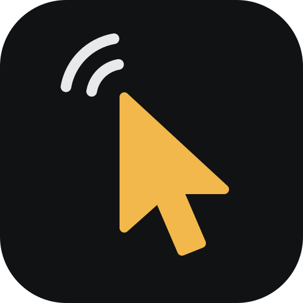
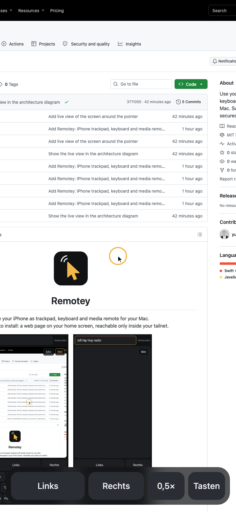
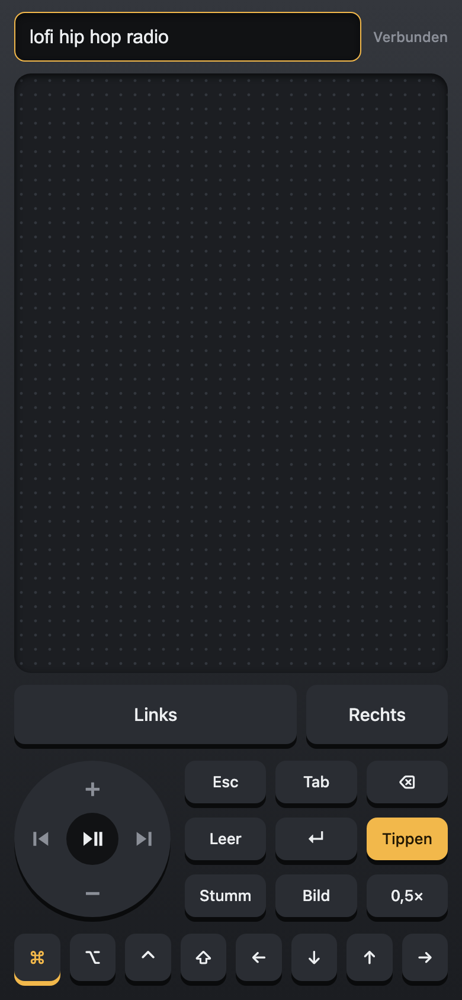

<p align="center">
  
</p>

<h1 align="center">Remotey</h1>

<p align="center">
  Use your iPhone as trackpad, keyboard and media remote for your Mac.<br>
  No iOS app to install: a web page on your home screen, reachable only inside your tailnet.
</p>

<p align="center">
  
  &nbsp;
  
  &nbsp;
  
</p>

## How it works


The agent is a small Swift menu bar app with no dependencies. The UI is a single HTML file (labels are in German).

## Security

An input remote is remote control of your Mac, so the agent is locked down in three layers:

- It binds to `127.0.0.1` only. Nothing is reachable from your Wi-Fi.
- `tailscale serve` terminates TLS and admits only devices in your tailnet.
- Every WebSocket must authenticate with a 256-bit token first. This also stops web pages in your Mac's browser from talking to the loopback port. The token travels in the URL fragment of the pairing link, which is never sent to the server, and can be rotated from the menu.

The live view sends screen content only to an authenticated client, only while it is switched on, over the same TLS connection.

## Setup

Requirements: macOS 14+, Xcode command line tools, Tailscale on the Mac and the iPhone (same account).

1. Build, sign and start the app:
   ```sh
   ./scripts/build.sh --install
   ```
2. Allow Remotey under System Settings → Privacy & Security → Accessibility.
   For the live view, also allow it under Screen & System Audio Recording and restart Remotey.
3. Publish the agent inside your tailnet (asks you to enable Serve once):
   ```sh
   ./scripts/tailscale-serve.sh
   ```
4. Click the menu bar icon → "iPhone koppeln (QR-Code)…" and scan the code with the iPhone camera.
5. In Safari, choose Share → Add to Home Screen.

The build signs with your "Apple Development" identity so macOS keeps the Accessibility permission across rebuilds. Set `REMOTEY_SIGN_IDENTITY` to use another one.

## Usage

| Gesture | Action |
|---|---|
| One finger | Move the pointer |
| Tap | Click |
| Two fingers | Scroll |
| Two-finger tap | Right click |
| Hold "Links" and swipe with a second finger | Drag |
| ⌘ ⌥ ⌃ ⇧ | Applies to the next key, e.g. ⌘ then `w` |
| "Bild" | Live view: a display above the trackpad shows the screen around the pointer; the key next to it zooms (0.5× to 2×) |
| Tap the display | Pointer mode: the live view fills the phone and the whole screen is the trackpad; "Tasten" goes back |
| Dial | Volume up and down, previous, play/pause, next |

Text typed on the iOS keyboard is replayed on the Mac key by key.

## Development

```sh
swift run               # agent from the source tree, Web/ is re-read on every request
node scripts/smoke.mjs  # checks HTTP, auth and pointer movement against the running agent
```

Known limits: untested on the Mac lock screen, and characters without a key in the active layout (emoji, for example) are sent as Unicode events, which some terminals ignore.

## License

MIT
